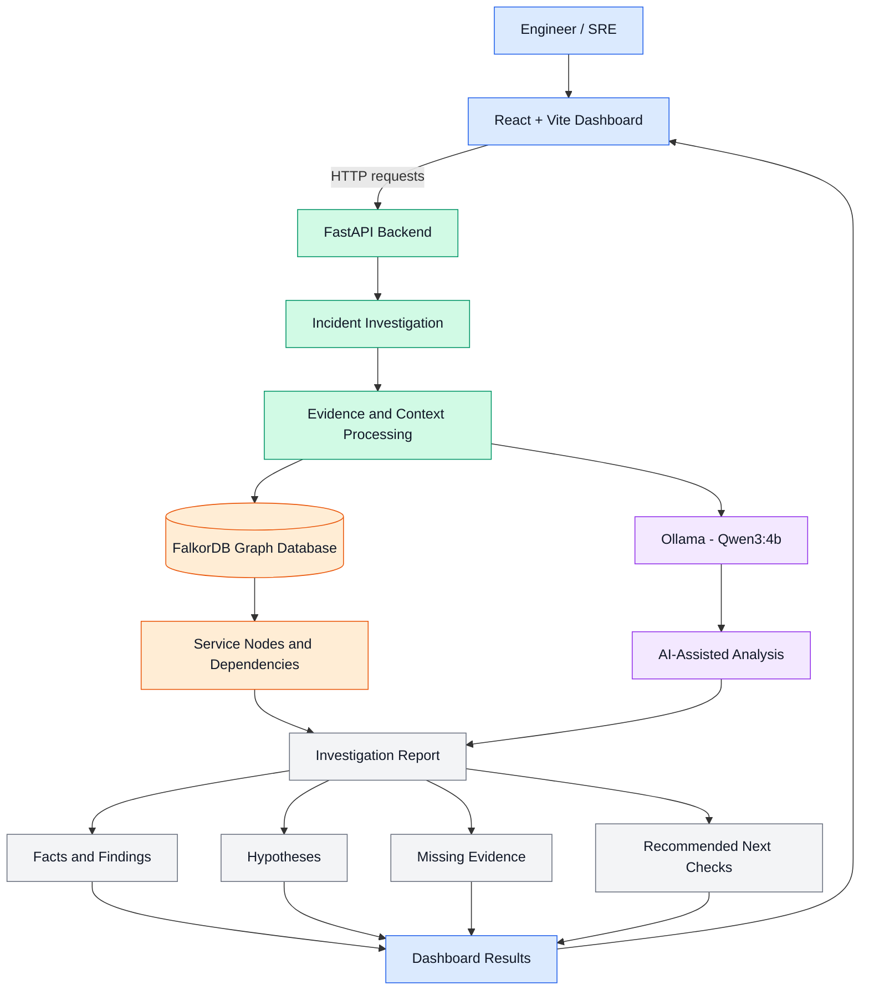

# IncidentGraph AI

AI-assisted incident investigation using FalkorDB, FastAPI, and Ollama.

## Features
- Graph-based service dependency tracing
- Deployment status inspection
- AI agent tool-calling
- Evidence, hypotheses, missing evidence, and recommended next checks

## Tech Stack
- Python
- FastAPI
- FalkorDB
- Ollama
- Pytest

## Run the API
Activate the project environment, ensure FalkorDB and Ollama are running, then execute:

```powershell
.\.venv\Scripts\python.exe -m uvicorn app:app --reload
```

Open http://127.0.0.1:8000/docs

## Demo
Use `POST /api/incidents/{incident_id}/investigate` with incident ID `INC-1042`.

## Tests
```powershell
.\.venv\Scripts\python.exe -m pytest -q .\test_agent_improved.py
```

## Limitations
Live service health monitoring is not integrated. The root cause remains a hypothesis until verified with deployment logs and monitoring metrics.


## 🏗️ System Architecture



### 🔍 How It Works

1. **Incident Input:** Engineers use the React dashboard to select and investigate incidents.
2. **Backend Orchestration:** FastAPI receives requests and coordinates the investigation workflow.
3. **Evidence Processing:** The backend organizes available incident details and relevant context.
4. **AI-Assisted Analysis:** Ollama runs the Qwen3:4b model to support investigation and hypothesis generation.
5. **Graph Intelligence:** FalkorDB stores relationships between services, helping the application explore dependencies and related context.
6. **Structured Results:** The dashboard presents findings, possible explanations, missing evidence, and suggested next checks.

### 🛠️ Technology Stack

| Component | Technology | Responsibility |
|---|---|---|
| Frontend | React + Vite | Interactive investigation dashboard |
| Backend | FastAPI | API and investigation workflow |
| AI Runtime | Ollama | Runs the local language model |
| AI Model | Qwen3:4b | AI-assisted incident analysis |
| Graph Database | FalkorDB | Service relationships and dependency context |
| Graph Format | Mermaid | Architecture visualization in README |

### 💡 Why FalkorDB?

FalkorDB provides a graph-based way to represent relationships between services and their dependencies. This connected context can help IncidentGraphAI explore how components relate to an incident instead of treating each service as an isolated entity.

The investigation output is intended to support engineers with structured findings and follow-up checks. Suggested root causes remain hypotheses until validated against appropriate logs, deployment records, and monitoring data.

