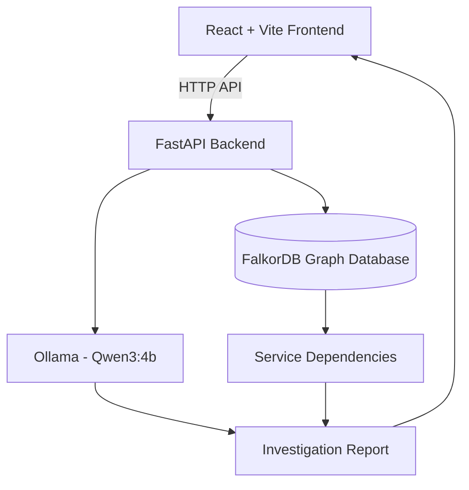

# IncidentGraph AI

AI-assisted incident investigation using FalkorDB, FastAPI, and Ollama.

## Features
- Graph-based service dependency tracing
- Deployment status inspection
- AI agent tool-calling
- Evidence, hypotheses, missing evidence, and recommended next checks

## Tech Stack
- Python
- FastAPI
- FalkorDB
- Ollama
- Pytest

## Run the API
Activate the project environment, ensure FalkorDB and Ollama are running, then execute:

```powershell
.\.venv\Scripts\python.exe -m uvicorn app:app --reload
```

Open http://127.0.0.1:8000/docs

## Demo
Use `POST /api/incidents/{incident_id}/investigate` with incident ID `INC-1042`.

## Tests
```powershell
.\.venv\Scripts\python.exe -m pytest -q .\test_agent_improved.py
```

## Limitations
Live service health monitoring is not integrated. The root cause remains a hypothesis until verified with deployment logs and monitoring metrics.

## Architecture



### How it works

- **React + Vite:** Provides the incident investigation interface.
- **FastAPI:** Handles backend requests and coordinates investigations.
- **Ollama (Qwen3:4b):** Supports AI-assisted incident analysis.
- **FalkorDB:** Stores and explores relationships between services.
